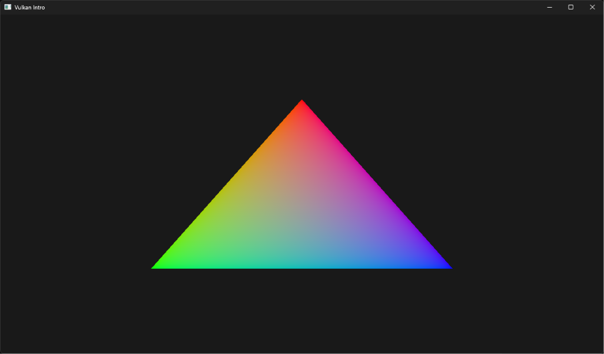

# Shader moderno dinamico in Vulkan

## Processo di sviluppo
Stamattina mi sono svegliato e pensavo a quanto fosse potente vulkan un OpenGL piu giovane e che potesse controllare al meglio l hardware.
Quello che non sapevo è che dell hardware sarebbe finito a controllare me ... 

Quindi ho deciso di provare a creare una semplice finestra renderizzando via GPU con degli shader un semplice triangolo, progetto che avevo gia fatto con OpenGL e che mi era anche abbastanza piaciuto.
Quindi ho seguito un corso di 2h che parlava di come sfruttre le ultime feature del moderno vulkan.

Il video durava due ore e l ho iniziato alle 9:30 e ho deciso che non mi sarei mosso finche non avrei visto il famigerato triangolo. 

Adesso sono le 21:00 ...

Dopo circa 8 h di programmazione non stop (delle quali circa la meta sono state dovute a problemi con le dipendeze come SDL3, Volk etc) sono riuscito a concludere il progetto.

Alla fine ho optato per usare vcpkg per le dipendenza cosi da avere una libreria che me le controlla in automatico mettendo tutti i file necessari nella cartella build.

## Quello che non si vede

Anche se sembra una semplice finestra il codice controlla tutto.

La maggior parte del lavoro è fatta durante l'inizializzazione all'avvio qui vengono eseguiti tutti una serie di processi:

- creazione istanza vulkan
- creazione surface per vulkan
- ricerca di physical Device (GPU)
- creazione della coda grafica (Queue)
- collegamento al device grafico
- inizializzazione VMA
- creazione swapchain per alternare frame renderizzato e in render
- compilazione degli shader in SPIR-V (a runtime)
- creazione della pipeline grafica (con anche rasterizzazione etc)
- sincronizzazione CPU e GPU
- creazione command buffer

## Conclusioni

Molto bello come progetto ma didattico, la curva di apprendimento iniziale è ripidissima, però man mano si riescono ad approfondire alcuni argomenti del C++ a basso livello come i puntatori gli header o le shader che possono sempre tornare utili.

Pensa che una persona che ha la piena padronanza di qeusto linguaggio sia tipo un dio sceso in terra perche richiede davvero una conoscenza profonda del funzionamento delle meccaniche di GPU e CPU.

Magari un domani riprendero le mie orme con vulkan chi lo sa, ma avere progetti C++ complessi con un numero cosi alto di righe di codice perché parliamo di 1100 righe di codice solo per la finestra e un sempice triangolo.

La difficolta di apprendimento di sintassi e di debug pero sono compensate dalle prestazini e feature moderne che offre.

## Il miraggio

